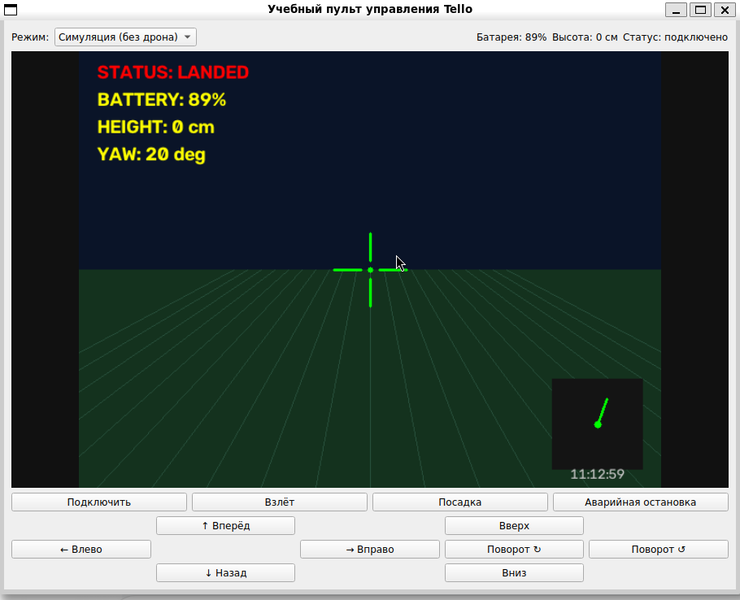

# Учебный проект: GUI-пульт управления дроном Tello

**Pet-project** по робототехнике и десктопной разработке. Пульт управления дроном Tello на PyQt5 с окном видеопотока и телеметрией.

Работает в двух режимах:
1. **Симуляция** (по умолчанию) — эмулятор дрона с синтетическим видеопотоком. Работает без физического дрона.
2. **Реальный Tello** — если дрон доступен по Wi-Fi. Подключается через `djitellopy`.

## Скриншот


## Стек
- Python 3.12
- PyQt5 (GUI)
- OpenCV (headless, обработка кадров)
- NumPy
- djitellopy (опционально — для реального дрона)

## Запуск
```bash
python3 -m venv venv
source venv/bin/activate
pip install -r requirements.txt
python3 app.py
